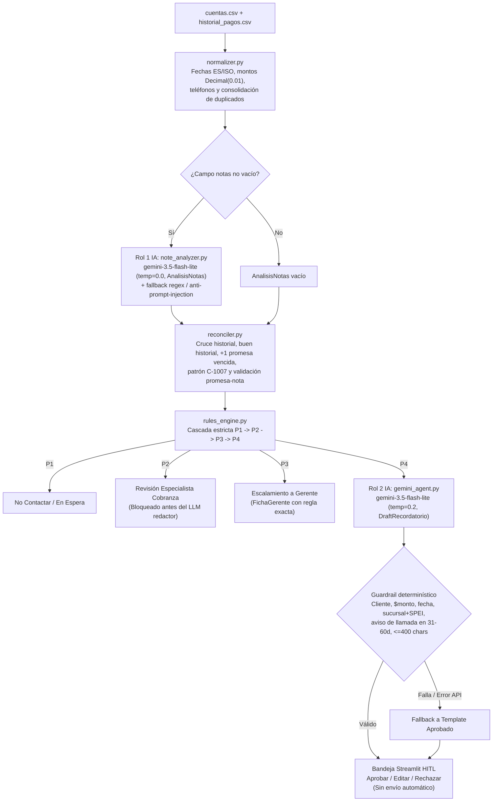

# Agente de Cobranza Preventiva (Human-in-the-Loop)

Sistema híbrido de cobranza preventiva que combina un **motor 100% determinístico en Python** (limpieza de datos sucios, conciliación de pagos y cascada de reglas) con **IA acotada mediante `google-genai` (`gemini-3.5-flash-lite` + Pydantic Structured Outputs)** únicamente para comprensión semántica del campo `notas` y redacción controlada de borradores SMS/WhatsApp bajo aprobación humana obligatoria (*Human-in-the-Loop*).

---

## Arquitectura Híbrida



### ¿Dónde SÍ y dónde NO se usa IA?

| Componente | Tecnología | Justificación |
| --- | --- | --- |
| Limpieza de fechas, montos (`Decimal`), teléfonos y duplicados | **Python determinístico** (`src/normalizer.py`) | Cero tolerancia a errores aritméticos o redondeos en saldos vencidos. |
| Comprensión de texto libre en `notas` | **Gemini `gemini-3.5-flash-lite` (`temp=0.0`, `AnalisisNotas`)** con fallback regex (`src/note_analyzer.py`) | Interpreta contexto humano complejo (ej. diferenciar `"convenio cancelado"` o `"queja cerrada"` de casos activos) sin hardcodear todas las variantes lingüísticas. |
| Conciliación, umbrales, fechas y cascada `P1→P2→P3→P4` | **Python determinístico** (`src/reconciler.py`, `src/rules_engine.py`) | Las políticas de contacto, precedencia y escalamiento deben ser 100% auditables y reproducibles. |
| Redacción de recordatorios SMS / WhatsApp | **Gemini `gemini-3.5-flash-lite` (`temp=0.2`, `DraftRecordatorio`)** + guardrails + fallback (`src/gemini_agent.py`) | Adapta el tono al canal/preferencia del cliente dentro de límites estrictos verificados automáticamente antes de mostrarlo al operador. |
| Decisión final de envío | **Humano (Streamlit HITL)** (`src/app.py`) | Nunca existe envío automático; el operador aprueba, edita o rechaza cada borrador. |

---

## Las 11 Reglas Validadas con Negocio

| # | Regla / Criterio | Implementación exacta |
| --- | --- | --- |
| 1 | **Monto a cobrar** | Usa siempre `monto_vencido` de `cuentas` (no marca saltos de 1.5x respecto a cuotas previas como inconsistencia). |
| 2 | **Días de atraso** | Usa `dias_atraso` estático de `cuentas` para segmentación y umbrales (no marca desfase contra `fecha_vencimiento` como error). |
| 3 | **Fecha de último pago** | Usa `historial_pagos` como fecha real en cajero (el desfase contra `cuentas.fecha_ultimo_pago` por compensación bancaria no es error). |
| 4 | **Fecha promesa de pago (+2 días incluidos)** | `fecha_promesa_pago` ya incluye 2 días de gracia: vigente si `fecha_corte <= fecha_promesa_pago`. Nota con `fecha_nota == fecha_promesa_pago - 2d` o fecha de llamada telefónica previa `<= fecha_promesa_pago` es consistente. |
| 5 | **Promesas incumplidas (+1 automático)** | Si `fecha_corte > fecha_promesa_pago` sin pago posterior, `promesas_incumplidas_efectivas = promesas_incumplidas + 1`; si `>= 2` escala a Gerente (P3). |
| 6 | **Buen historial (`<= 1` atraso en 12m)** | Respeta estrictamente la etiqueta `"a tiempo"` en `historial_pagos` (incluso `+1 día`) y excluye `"pendiente"`. Amplía tono *Amistoso* de `1–7` a `1–15` días. |
| 7 | **Patrón `C-1007` (Datos que no cuadran)** | Cuenta activa/vencida en `cuentas` sin ninguna fila `"pendiente"` en `historial_pagos` se clasifica obligatoriamente en P2 (`Revisión Especialista Cobranza`). |
| 8 | **Precedencia P1 (No Contactar)** | Retiene por convenio vigente, promesa vigente (no escala a Gerente), pago/comprobante pendiente (si no hay `C-1007` ni queja abierta) o contacto reciente `<= 5` días naturales. |
| 9 | **Precedencia P2 (Especialista)** | Queja o disputa abierta (bloqueada antes del LLM redactor; no escala a Gerente), teléfono inválido/faltante o inconsistencias críticas (`2026-11-31`, `monto <= 0` con `dias_atraso > 0`, conflictos de nota). Mantiene `alerta_secundaria_gerente` si supera P3. |
| 10 | **Precedencia P3 (Escalar a Gerente)** | Estricto `monto_vencido > $50,000.00` (`$50,000.00` no escala), `dias_atraso > 60` (`60` no escala) o `promesas_incumplidas_efectivas >= 2`. Emite `FichaGerente` con regla exacta. |
| 11 | **Precedencia P4 (Drafts + Guardrails)** | Segmentos *Amistoso* (`1–7` / `1–15`), *Firme + opciones de pago* (`8–30` / `16–30`), *Formal + llamada* (`31–60`, exige aviso de llamada y `requiere_llamada_cobrador=True`). Exige nombre, `$X,XXX.XX`, vencimiento, `sucursal` y `SPEI`, `<=400` chars y cero palabras prohibidas. |

---

## Instalación y Ejecución

```bash
pip install -r requirements.txt
cp .env.example .env
# Configura GEMINI_API_KEY en .env (opcional si usas --mock-llm)
```

### 1. Pipeline CLI
```bash
# Modo determinístico / mock (sin consumir cuota de API)
python -m src.pipeline --mock-llm --fecha-corte 2026-11-24

# Con Gemini API (gemini-2.5-flash)
python -m src.pipeline --fecha-corte 2026-11-24
```
Genera `output/reporte_cobranza.json`.

### 2. Interfaz Web Streamlit (Human-in-the-Loop)
```bash
streamlit run src/app.py
```

### 3. Pruebas y Evaluaciones
```bash
pytest -v
```

---

## Resultados Reales sobre el Dataset del Workspace (`fecha_corte = 2026-11-24`)

`data/cuentas.csv` contiene 63 filas crudas que se consolidan en **60 cuentas únicas** (fusionando el duplicado de ID `C-1006`, el duplicado de ID `C-1052` y el registro clonado `C-1061 -> C-1017` sin historial propio):

| Categoría | Cantidad | Casos representativos |
| --- | :---: | --- |
| **P1 — No Contactar / En Espera** | **13** | Convenios vigentes (`C-1032`, `C-1055`, `C-1051`, `C-1011`, `C-1057`), promesas vigentes (`C-1005`, `C-1041`, `C-1028`), depósito pendiente (`C-1058`), contacto `<=5d` (`C-1023`, `C-1060`, `C-1030`, `C-1036`). |
| **P2 — Revisión Especialista Cobranza** | **8** | Patrón sin pendiente (`C-1007`), fecha corrupta `2026-11-31` (`C-1033`), sin teléfono (`C-1027`, `C-1045`), quejas/disputas abiertas (`C-1001`, `C-1004`, `C-1021`, `C-1050`). |
| **P3 — Escalamiento a Gerente** | **11** | Monto > `$50,000.00` (`C-1049`, `C-1053`, `C-1029`, `C-1008` con `$50,000.01`), atraso > 60d (`C-1026`, `C-1034`, `C-1048`, `C-1043`), `>= 2` promesas incumplidas tras `+1` (`C-1018`, `C-1019`, `C-1025`). |
| **P4 — Borradores por Aprobar** | **28** | **11** *Amistoso*, **10** *Firme + opciones de pago* (incl. `C-1031` con promesa vencida `+1=1`, `C-1037` convenio cancelado, `C-1038` queja resuelta), **7** *Formal + llamada* (incl. `C-1040` con `$50,000.00` exactos y `C-1056`). |
| **Alertas secundarias a Gerente** | **4** | `C-1055`, `C-1041`, `C-1051` (retenidas en P1) y `C-1050` (retenida en P2 por queja con `$58,000.00`). |

### KPIs de Evaluación (`tests/test_evaluacion.py`)
1. **Tasa de Falsos Positivos en Contacto:** `0.0%`
2. **Recall en Escalamientos Críticos al Gerente:** `100.0%`
3. **Fidelidad de Datos en Drafts (montos, vencimiento, sucursal/SPEI, aviso de llamada):** `100.0%`

---

## Riesgos y Mitigaciones

1. **Desfase entre pagos en cajero vs compensación bancaria (`historial_pagos` vs `cuentas.fecha_ultimo_pago`):**
   - *Riesgo:* Contactar a un cliente que ya depositó en cajero o conciliación bancaria pendiente.
   - *Mitigación:* El conciliador toma `historial_pagos` como fuente real sin penalizar desfases bancarios y el motor P1 retiene explícitamente cuentas con depósito/comprobante pendiente de aplicar (`C-1058`), evitando el envío de recordatorios prematuros.
2. **Prompt Injection o texto hostil en el campo `notas`:**
   - *Riesgo:* Una nota con instrucciones maliciosas podría manipular al LLM redactor para filtrar datos o cambiar montos.
   - *Mitigación:* Las cuentas con queja/disputa o notas sensibles se bloquean en P2 **antes** de llegar al LLM redactor; `note_analyzer.py` delimita la nota en `<nota_cliente>` con detector previo por regex y nunca tiene acceso a herramientas externas ni a modificación de montos/reglas.
3. **Rate limits (HTTP 429) o indisponibilidad de la API gratuita de Gemini:**
   - *Riesgo:* Interrupción de la operación diaria por cuotas de `gemini-3.5-flash-lite`.
   - *Mitigación:* Backoff exponencial automático en `note_analyzer.py` y `gemini_agent.py`, y degradación elegante a extractor determinístico por regex y templates aprobados por segmento (`origen_borrador="template_fallback"`), manteniendo 100% la continuidad operativa.

---

## Plan de Despliegue Gradual

- **Semanas 1–2 (Modo Asistido 100% Humano / Shadow & HITL):**
  - Todas las cuentas P4 pasan por revisión y aprobación manual en Streamlit (`Aprobar` / `Editar` / `Rechazar`), registrando tasa de aprobación sin ediciones y motivos de rechazo.
  - Revisión diaria conjunta entre Operaciones y Riesgos sobre cuentas P2 y alertas secundarias de Gerente.
- **Semanas 3–4 (Automatización Parcial Acotada):**
  - Criterio de salida: alcanzar **>98% de aprobación sin ediciones** durante las semanas 1–2, `0.0%` de falsos positivos en contacto y `100%` de fidelidad en guardrails.
  - Habilitar despacho automático **exclusivamente** para el segmento **Amistoso (`1–7 días` de atraso, sin notas de riesgo y sin historial conflictivo)**, manteniendo obligatoriamente Human-in-the-Loop para *Firme (`8–30`)*, *Formal + llamada (`31–60`)* y todo escalamiento P2/P3.
